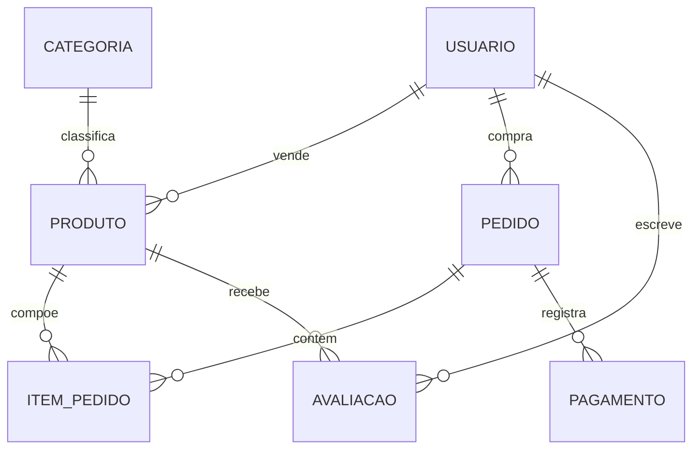
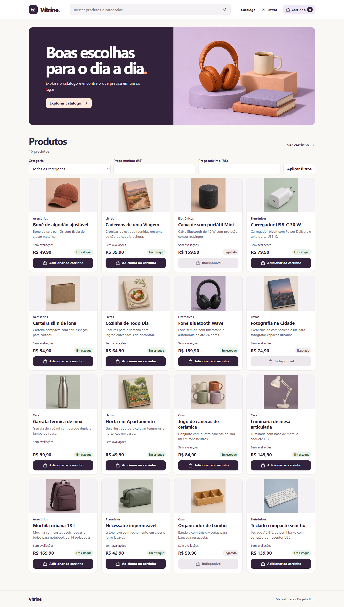
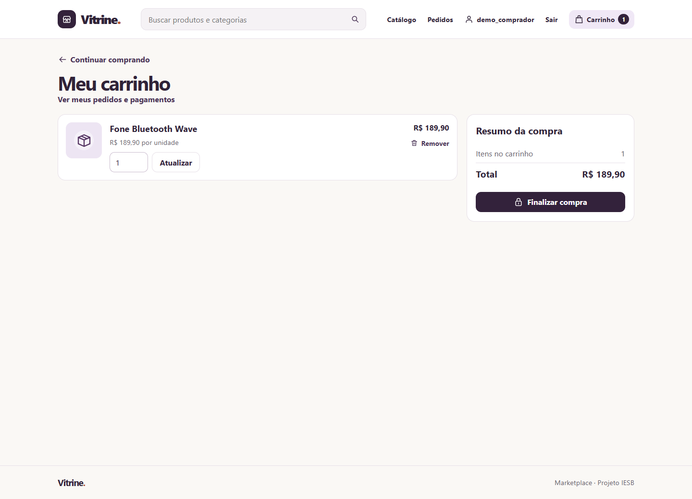
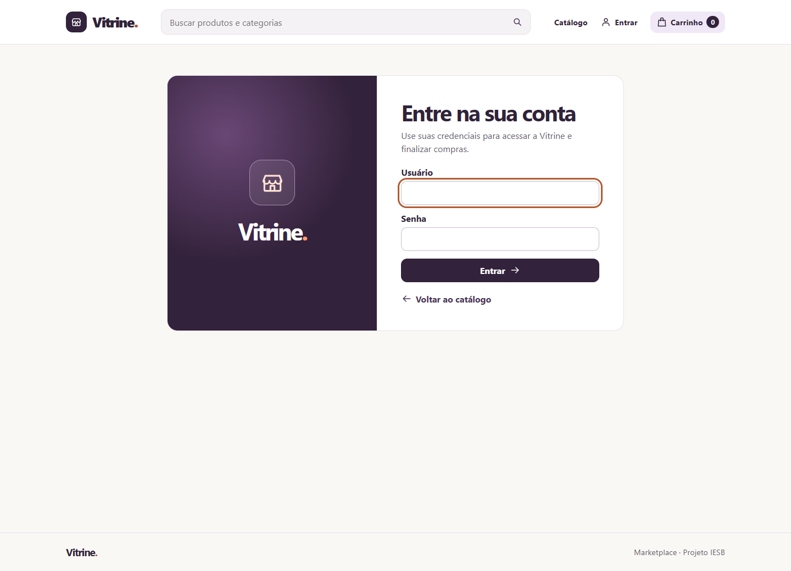
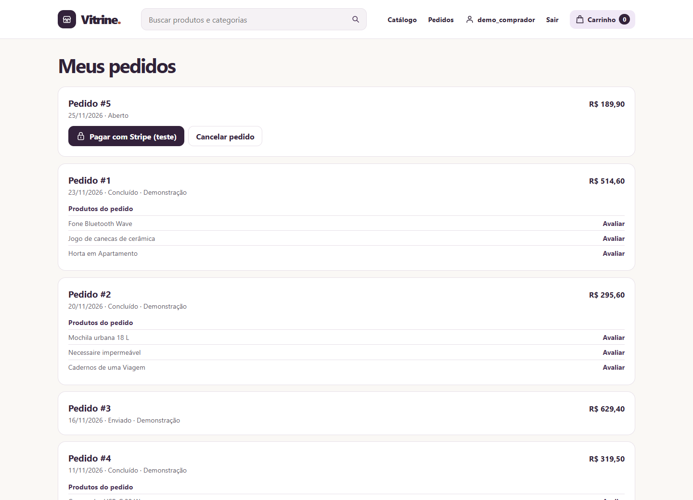
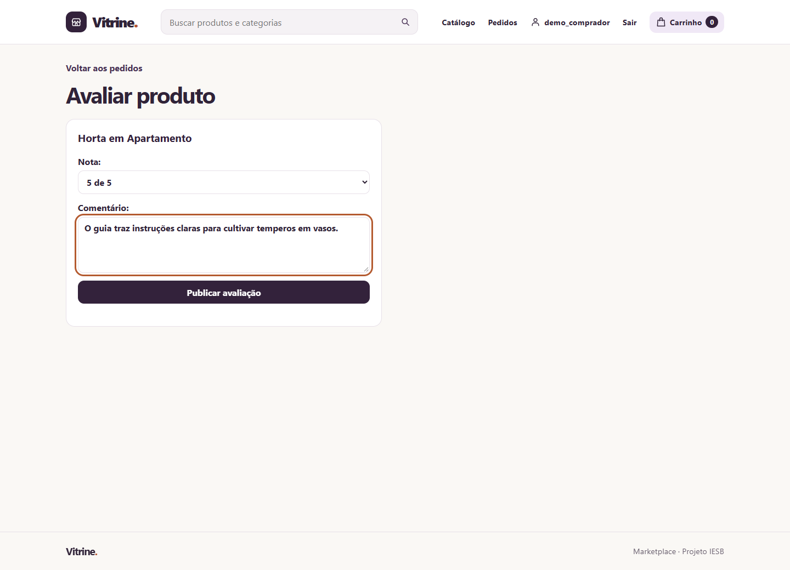
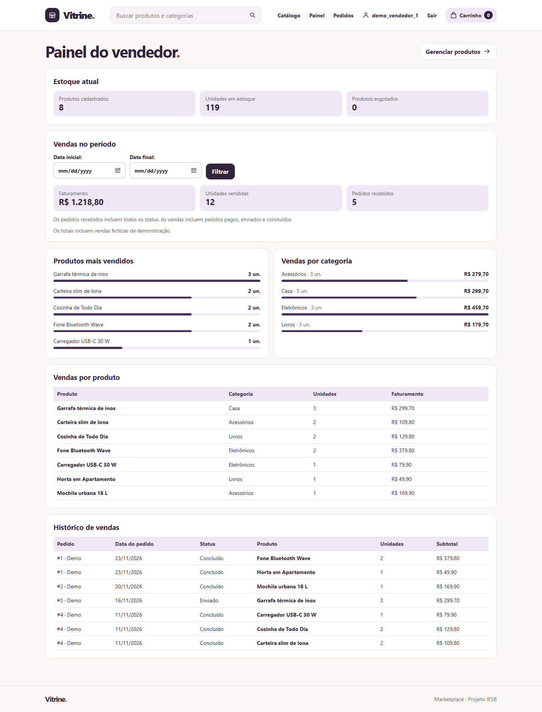
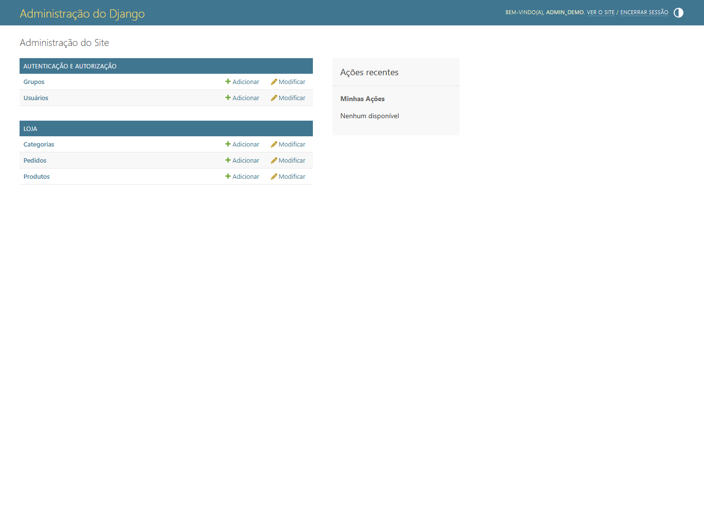
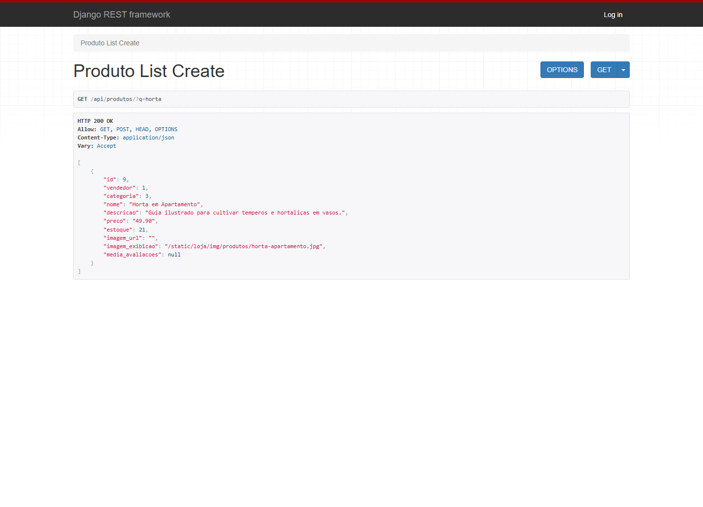
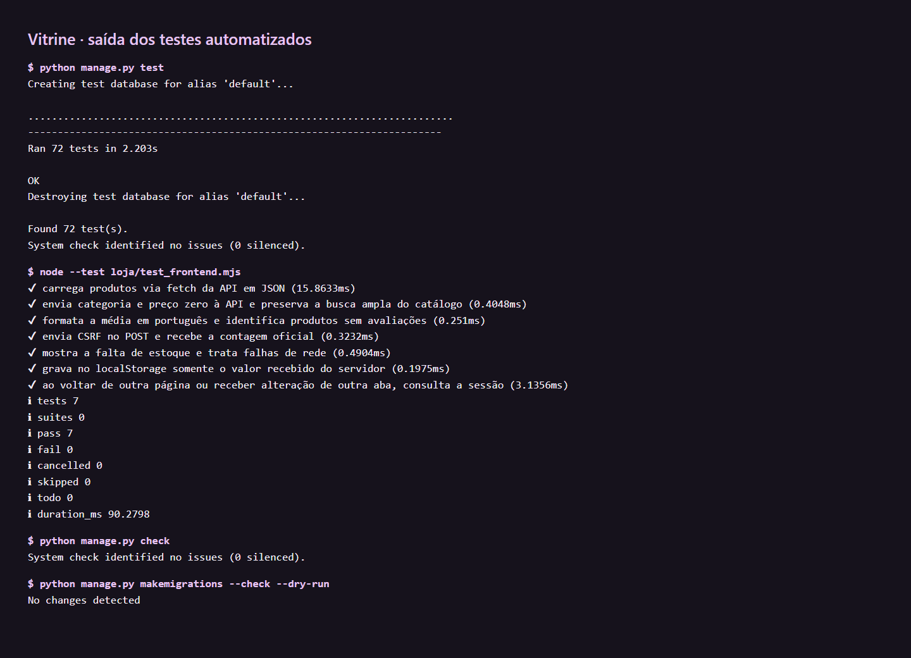

# Vitrine · Marketplace

Projeto 5 da disciplina Construção de Backend no IESB. A Vitrine reúne catálogo, estoque, pedidos, pagamentos de teste e acompanhamento de vendas em uma aplicação web responsiva.

[Acesse o Marketplace Vitrine no Render](https://vitrine-marketplace.onrender.com)

## Problema e proposta de valor

Pequenos comerciantes que começam a vender pela internet muitas vezes administram produtos, pedidos e estoque em canais separados. Isso torna mais difícil manter a disponibilidade atualizada e acompanhar o que foi vendido. A Vitrine facilita a entrada no comércio digital ao centralizar produtos, estoques, pedidos, pagamentos e acompanhamento de vendas.

O público principal são pequenos lojistas e comerciantes independentes. Para quem compra, a plataforma oferece um catálogo pesquisável, acompanhamento de pedidos e avaliações vinculadas a compras concluídas.

## Tecnologias

| Camada | Tecnologia |
| --- | --- |
| Aplicação | Python 3.14 e Django 6.1.3 |
| API | Django REST Framework 3.18.3 |
| Persistência | SQLite para desenvolvimento, PostgreSQL via `DATABASE_URL`, Django ORM e migrações |
| Interface | Django Templates, HTML semântico, CSS, JavaScript modular e Fetch API |
| Pagamento | Stripe Checkout em sandbox, SDK Stripe 17.1.0 e webhook assinado |
| Serviço web | Gunicorn (WSGI), WhiteNoise e Blueprint do Render |
| Testes | Test runner do Django e `node:test` |

## Arquitetura e estrutura

A aplicação segue o padrão Model–Template–View do Django. As páginas HTML e a API usam os mesmos modelos e compartilham a lógica de reserva de estoque e criação de pedidos. O navegador usa a API para carregar o catálogo e atualiza o carrinho pela sessão. O catálogo também pode ser consultado e filtrado sem JavaScript.

```text
.
├── manage.py                   # Comandos Django
├── marketplace/                # Configuração, URLs e entradas ASGI/WSGI
├── loja/
│   ├── models.py               # Entidades e restrições do banco
│   ├── urls.py                 # Rotas das páginas, da API e do webhook
│   ├── api_views.py           # Endpoints REST
│   ├── serializers.py         # Validação e representação JSON
│   ├── checkout.py            # Criação e cancelamento atômicos
│   ├── pagamentos.py          # Sessões Checkout e processamento de eventos
│   ├── pagamento_views.py      # Histórico, retornos e webhook HTTP
│   ├── avaliacoes.py           # Formulário e registro da avaliação
│   ├── painel_vendedor.py      # Relatórios de estoque e vendas
│   ├── management/commands/    # Seed, senhas demo e expiração de pedidos
│   ├── migrations/             # Histórico do esquema
│   ├── templates/              # Páginas e login personalizado
│   └── static/loja/            # Estilos, módulos JS e imagens locais
├── docs/screenshots/           # Capturas da aplicação e dos testes
├── .env.example                # Nomes das variáveis com exemplos fictícios
├── render.yaml                 # Blueprint de demonstração para o Render
├── render-build.sh             # Instalação, coleta de estáticos e migrações
└── requirements.txt            # Dependências Python fixadas
```

## Modelagem do banco



| Entidade | Responsabilidade |
| --- | --- |
| Usuário | Conta Django. O papel depende da ação, da propriedade dos dados e das permissões da conta. |
| Categoria | Nome único usado na organização e no filtro do catálogo. |
| Produto | Vendedor, categoria, descrição, preço vigente, estoque e imagem opcional. |
| Pedido | Comprador, status, data, controle de reserva e referência opcional de demonstração. |
| ItemPedido | Produto, quantidade e preço unitário registrado no momento da compra. O checkout exige pelo menos um item. |
| Pagamento | Tentativa Stripe com UUID, total em centavos, moeda, estado e identificadores externos únicos. Um pedido pode ter várias tentativas históricas, com no máximo uma pendente ou confirmada por vez. |
| Avaliação | Nota de 1 a 5 e comentário. Cada comprador pode avaliar um produto uma vez após uma compra concluída. |

O [modelo Django](loja/models.py) define as chaves estrangeiras e as restrições de nota, quantidade, preço e unicidade.

## Funcionalidades por perfil

| Perfil | Funcionalidades |
| --- | --- |
| Visitante | Navegar e pesquisar no catálogo, filtrar por categoria e preço, consultar estoque e médias de avaliações e montar um carrinho na sessão. |
| Comprador | Finalizar compra, ver os próprios pedidos e tentativas de pagamento, iniciar ou retomar o Checkout de teste, cancelar pedidos elegíveis e avaliar produtos comprados em pedidos concluídos. |
| Vendedor | Gerenciar os próprios produtos no Django Admin quando autorizado. O painel `/vendedor/` mostra estoque atual, faturamento, unidades vendidas, pedidos recebidos, relatórios por produto e categoria, ranking e histórico filtrável. |
| Administrador | Gerenciar usuários, permissões, categorias e produtos no Django Admin. Pode acompanhar pedidos e avançar os estados de expedição permitidos. O webhook validado confirma o pagamento. |

O painel exige conta ativa da equipe com permissão de visualização ou alteração de produtos. Cada vendedor vê apenas seus itens, mesmo quando um pedido tem produtos de várias lojas. Pedidos recebidos contam todos os status, enquanto o faturamento considera itens de pedidos `PAGO`, `ENVIADO` ou `CONCLUIDO` pelo preço histórico. O filtro usa a data de criação do pedido.

## Fluxo de compra e estoque

1. O carrinho fica na sessão. O checkout revalida a disponibilidade de todos os produtos e cria o pedido `ABERTO` e seus itens em uma transação atômica. A baixa usa uma atualização condicionada ao estoque suficiente. Se uma operação falhar, todas as alterações são revertidas.
2. O comprador inicia o pagamento em **Pedidos**. O servidor soma os preços históricos dos itens e solicita uma sessão Stripe Checkout em BRL. A tentativa usa uma chave de idempotência e pode reaproveitar a sessão existente.
3. O webhook valida a assinatura do corpo original, o ambiente de teste, a sessão, o pedido, a moeda, o total e o estado confirmado. O pedido passa para `PAGO` uma só vez. A baixa de estoque já ocorreu no checkout. O retorno do navegador exibe o estado conhecido localmente.
4. O administrador pode avançar o pedido para `ENVIADO` ou `CONCLUIDO` dentro das transições permitidas. O comprador pode avaliar após a conclusão. Um pedido aberto pode ser cancelado quando não houver pagamento pendente ou confirmado. O cancelamento e a devolução das unidades reservadas ocorrem na mesma transação.

### Pedidos abandonados

```bash
python manage.py expirar_pedidos
```

O comando procura pedidos abertos há pelo menos 24 horas, cancela os elegíveis e devolve o estoque uma única vez. Se houver uma sessão Stripe conhecida, o comando pode consultar o sandbox para confirmar que ela expirou sem pagamento. Tentativas sem confirmação segura permanecem sinalizadas para verificação. Se uma sessão constar como paga, a confirmação local continua dependendo do webhook. Execute o comando manualmente ou configure uma rotina periódica no ambiente de execução.

## API REST

| Método e rota | Acesso e comportamento |
| --- | --- |
| `GET /api/produtos/` | Público. Aceita `categoria` pelo ID, `preco_min`, `preco_max` e `q` para busca por nome. Os limites de preço são inclusivos. |
| `POST /api/produtos/` | Usuário autenticado. O vendedor é a conta da requisição. |
| `POST /api/pedidos/` | Usuário autenticado. Cria o pedido para a conta da requisição e reserva estoque. O servidor calcula preços e total. |
| `POST /api/avaliacoes/` | Usuário autenticado com compra concluída do produto. Aceita uma avaliação por comprador e produto. |
| `POST /stripe/webhook/` | Endpoint de integração. A Stripe autentica o envio com `Stripe-Signature`. |

Os exemplos foram executados em um banco isolado com `seed_demo`. IDs e datas variam por banco. Os comandos `curl` usam a sintaxe de Bash e pedem a senha interativamente em `--user`. No navegador, a API navegável do DRF usa a sessão Django e o token CSRF nas escritas.

Filtros inválidos, estoque insuficiente e avaliações inelegíveis geram respostas `400` com detalhes de validação. Requisições de escrita exigem autenticação.

### Consultar produtos

```bash
curl -H 'Accept: application/json' 'http://127.0.0.1:8000/api/produtos/?q=horta'
```

Resposta `200 OK`.

```json
[
  {
    "id": 9, "vendedor": 1, "categoria": 3, "nome": "Horta em Apartamento",
    "descricao": "Guia ilustrado para cultivar temperos e hortaliças em vasos.",
    "preco": "49.90", "estoque": 21, "imagem_url": "",
    "imagem_exibicao": "/static/loja/img/produtos/horta-apartamento.jpg",
    "media_avaliacoes": null
  }
]
```

### Cadastrar produto

```bash
curl --user demo_vendedor_1 -H 'Content-Type: application/json' \
  --data '{"categoria":3,"nome":"Marcador de páginas","descricao":"Marcador de papel reciclado.","preco":"4.90","estoque":20}' \
  http://127.0.0.1:8000/api/produtos/
```

Resposta `201 Created`.

```json
{
  "id": 17, "vendedor": 1, "categoria": 3, "nome": "Marcador de páginas",
  "descricao": "Marcador de papel reciclado.", "preco": "4.90", "estoque": 20,
  "imagem_url": "", "imagem_exibicao": "", "media_avaliacoes": null
}
```

### Criar pedido

```bash
curl --user demo_comprador -H 'Content-Type: application/json' \
  --data '{"itens":[{"produto":9,"quantidade":2}]}' \
  http://127.0.0.1:8000/api/pedidos/
```

Resposta `201 Created`.

```json
{
  "id": 6, "comprador": 3, "status": "ABERTO",
  "criado_em": "2026-11-25T23:09:34.149037-03:00",
  "itens": [{"id": 14, "produto": 9, "quantidade": 2, "preco_unitario": "49.90", "subtotal": "99.80"}],
  "total": "99.80"
}
```

### Publicar avaliação

O `seed_demo` já registra uma compra concluída de **Horta em Apartamento** para `demo_comprador`, permitindo reproduzir o exemplo em um banco de demonstração sem avaliação anterior desse produto.

```bash
curl --user demo_comprador -H 'Content-Type: application/json' \
  --data '{"produto":9,"nota":5,"comentario":"Ótimo guia para começar uma horta."}' \
  http://127.0.0.1:8000/api/avaliacoes/
```

Resposta `201 Created`.

```json
{"id":1,"produto":9,"nota":5,"comentario":"Ótimo guia para começar uma horta."}
```

## Instalação e execução

Na raiz do projeto, com Python 3.14 e `pip` instalados, crie o ambiente virtual.

```powershell
# Windows PowerShell
python -m venv venv
.\venv\Scripts\Activate.ps1
```

```bash
# Linux ou macOS
python3 -m venv venv
source venv/bin/activate
```

Se a política do PowerShell impedir a ativação, use `./venv/Scripts/python.exe` no lugar de `python` nos comandos a seguir.

```bash
python -m pip install -r requirements.txt
python manage.py migrate
python manage.py seed_demo
python manage.py runserver 127.0.0.1:8000
```

Abra `http://127.0.0.1:8000/`. O Django cria o banco SQLite local ao aplicar as migrações. Para administrar a aplicação, crie uma conta separada com `python manage.py createsuperuser` e use `/admin/`.

O [`.env.example`](.env.example) lista as variáveis aceitas. O Django lê as variáveis do processo. Se optar por um arquivo `.env` local, carregue-o no ambiente antes de iniciar o servidor. Use uma `DJANGO_SECRET_KEY` aleatória e estável para manter as sessões entre reinícios. Em desenvolvimento, a ausência de chave gera uma temporária. Com `DJANGO_DEBUG=0`, a chave é obrigatória. `DJANGO_ALLOWED_HOSTS` recebe uma lista separada por vírgulas. O [`.gitignore`](.gitignore) exclui arquivos de ambiente locais, o ambiente virtual e o banco SQLite.

Para gerar e carregar uma chave na sessão do terminal em desenvolvimento, rode um dos exemplos abaixo depois de instalar as dependências. Para manter sessões entre reinícios do terminal, reutilize a mesma chave a partir do seu armazenamento local de segredos.

```powershell
$env:DJANGO_SECRET_KEY = python -c 'from django.core.management.utils import get_random_secret_key; print(get_random_secret_key())'
$env:DJANGO_ALLOWED_HOSTS = 'localhost,127.0.0.1'
```

```bash
export DJANGO_SECRET_KEY="$(python -c 'from django.core.management.utils import get_random_secret_key; print(get_random_secret_key())')"
export DJANGO_ALLOWED_HOSTS='localhost,127.0.0.1'
```

### Contas demonstrativas

O `seed_demo` é idempotente. Prepara 16 produtos com imagens locais, quatro categorias, dois vendedores, um comprador e quatro pedidos sinalizados como demonstração. As vendas fictícias preenchem os painéis sem criar pagamentos Stripe. As contas novas começam com senha desativada. Defina somente as que desejar usar, em terminal interativo.

```bash
python manage.py configurar_senha_demo demo_comprador
python manage.py configurar_senha_demo demo_vendedor_1
python manage.py configurar_senha_demo demo_vendedor_2
```

A senha é digitada sem eco, pede confirmação e passa pelos validadores do Django. Entre por `/api-auth/login/`. Como comprador, use `/pedidos/` para experimentar a avaliação. Como vendedor, acesse `/vendedor/` para ver seus relatórios.

### Primeiro login das contas demo no Render

Em **Environment**, no painel do serviço, defina uma senha forte e distinta para cada conta que desejar habilitar. Selecione **Save, rebuild, and deploy**.

| Variável opcional | Conta |
| --- | --- |
| `DEMO_BUYER_PASSWORD` | `demo_comprador` |
| `DEMO_SELLER_1_PASSWORD` | `demo_vendedor_1` |
| `DEMO_SELLER_2_PASSWORD` | `demo_vendedor_2` |

O build executa `python manage.py configurar_senha_demo --from-env` após as migrações e o seed opcional. Se as contas já existirem, `SEED_DEMO=1` pode ficar desativado. O comando ignora variáveis vazias e contas com senha utilizável. Ele mantém as permissões e o estado de ativação existentes. Se uma conta configurada estiver ausente ou os validadores do Django rejeitarem uma senha nova, o build informa o nome da conta ou da variável e reverte as alterações de senha dessa execução.

Após confirmar o login, remova as variáveis de senha do Render. As senhas permanecem armazenadas como hashes no PostgreSQL. Use o comando interativo para alterar intencionalmente uma senha existente.

### Stripe em sandbox

A homologação de ponta a ponta foi concluída em 26/11/2026 no Stripe Sandbox. O pedido **#6**, de **R$ 49,90**, foi confirmado em `PAGO`. A sessão no Stripe estava `complete` e `paid`, e o evento `checkout.session.completed` conferia com o webhook processado pelo Django. O produto permaneceu com **6 unidades em estoque** após o pagamento, sem segunda baixa. As suítes automatizadas continuam usando mocks e assinaturas locais.


1. Defina `STRIPE_SECRET_KEY` com uma chave `sk_test_…` do sandbox e `STRIPE_PUBLIC_ORIGIN` com o endereço usado para acessar a Vitrine.
2. Autentique a Stripe CLI no mesmo sandbox e encaminhe os eventos ao servidor local. Exporte o segredo informado pela CLI em `STRIPE_WEBHOOK_SECRET` e reinicie o Django com as variáveis carregadas. [Referência da Stripe CLI](https://docs.stripe.com/cli)

   ```bash
   stripe listen --events checkout.session.completed,checkout.session.expired --forward-to http://127.0.0.1:8000/stripe/webhook/
   ```

3. Crie um pedido aberto pelo carrinho e pague por `/pedidos/`. Use um cartão de teste e confira tanto a entrega do webhook quanto o status `PAGO` no histórico. [Cartões de teste da Stripe](https://docs.stripe.com/testing)

## Deploy no Render

O [Blueprint](render.yaml) define um serviço web e um banco PostgreSQL privado no plano gratuito, adequado para demonstração acadêmica. A aplicação usa Gunicorn como servidor WSGI. O [script de build](render-build.sh) instala as dependências, coleta os arquivos estáticos para `staticfiles/` e aplica as migrações ao PostgreSQL. Em produção, o WhiteNoise serve os arquivos coletados com nomes versionados. Os planos gratuitos têm limites, incluindo suspensão do serviço web por inatividade e expiração do PostgreSQL após 30 dias. [Guia Django no Render](https://render.com/docs/deploy-django) · [Limites do plano gratuito](https://render.com/docs/free)

Quando estiver pronto para publicar, conecte o repositório no Render e revise os recursos e planos do Blueprint antes de aplicar. A configuração usa deploy manual após o provisionamento inicial. O Render injeta o hostname público e conecta o serviço à URL interna do PostgreSQL. Se usar um domínio próprio, configure DNS/TLS no Render e informe o hostname e a origem HTTPS nas variáveis do serviço. [Referência de Blueprints](https://render.com/docs/blueprint-spec)

### Variáveis de ambiente

| Variável | Uso |
| --- | --- |
| `DJANGO_DEBUG` | `1` no desenvolvimento local. Use `0` no deploy. O Blueprint já define `0`. |
| `DJANGO_SECRET_KEY` | Chave aleatória e estável, obrigatória com `DJANGO_DEBUG=0`. O Blueprint gera o valor. |
| `DJANGO_ALLOWED_HOSTS` | Hostnames explícitos, separados por vírgula, sem esquema nem porta. O hostname `onrender.com` do serviço é incluído automaticamente. |
| `DJANGO_CSRF_TRUSTED_ORIGINS` | Origens HTTPS adicionais, separadas por vírgula, como `https://loja.example.com`. A origem do serviço Render é incluída automaticamente. |
| `DJANGO_TRUST_PROXY_HTTPS` | `1` fora do Render somente se o proxy confiável substituir `X-Forwarded-Proto`. O Render recebe esta configuração automaticamente. |
| `DATABASE_URL` | URL `postgresql://` ou `postgres://`. Obrigatória em produção e ligada ao banco do Blueprint. Se estiver vazia em desenvolvimento, o Django usa SQLite. Para conexões externas ao Render, use a URL externa, restrinja o IP de origem e configure TLS. |
| `SEED_DEMO` | Defina `1` para popular o banco com dados de demonstração no build, após as migrações. Ausente ou com outro valor, o build segue sem executar o seed. |
| `STRIPE_SECRET_KEY` | Chave `sk_test_…` do sandbox, se for habilitar pagamentos. |
| `STRIPE_WEBHOOK_SECRET` | Segredo de assinatura do endpoint Stripe. O segredo da CLI é próprio do encaminhamento local. |
| `STRIPE_PUBLIC_ORIGIN` | Origem pública HTTPS usada para os retornos do Stripe, se for habilitar pagamentos. |
| `PYTHON_VERSION` e `PORT` | O Blueprint fixa Python 3.14.10. O Render fornece `PORT` ao Gunicorn. |

Configure os segredos no painel do Render ou no ambiente do processo local. O [`.env.example`](.env.example) serve como referência. Se precisar preservar dados do SQLite, planeje a migração dos dados separadamente. Para criar um superusuário, use um terminal autorizado com acesso ao banco, pois o plano web gratuito não oferece shell no Render.

### Popular o PostgreSQL com dados de demonstração

1. No painel do serviço `vitrine-marketplace`, abra **Environment** e adicione `SEED_DEMO=1`.
2. Escolha **Save, rebuild, and deploy** e confirme que o deploy usa a versão que inclui a opção no `render-build.sh`. O seed roda depois das migrações. [Variáveis de ambiente do Render](https://render.com/docs/configure-environment-variables)
3. Confira nos logs do build os totais criados e abra o catálogo público. Num banco vazio, o seed cria 16 produtos, quatro categorias, três contas com senha desativada e quatro pedidos fictícios. As reexecuções reaproveitam produtos por vendedor e nome e preservam dados já cadastrados. Remova a variável ou ajuste para `0` quando quiser pular o seed em builds futuros.

Após o deploy, confirme que o catálogo, o login e os arquivos estáticos funcionam por HTTPS, confira os logs de build e execute `python manage.py check --deploy` com as variáveis de produção. O HSTS cobre o domínio servido. A inclusão de subdomínios e o preload ficam desativados até haver uma política de domínio que permita ativá-los. O backend de e-mail de console é exclusivo do desenvolvimento. Caso passe a enviar e-mail em produção, configure um provedor compatível com o ambiente de execução.

### Rotina de expiração em produção

Agende `python manage.py expirar_pedidos` de hora em hora em um executor com a mesma versão do projeto, variáveis do Django e acesso autorizado ao PostgreSQL. Se for importar o ambiente no agendador, guarde o arquivo de variáveis fora do repositório com permissões restritas. Em um executor externo, mantenha a regra de acesso ao banco restrita ao IP do executor e use TLS. Mantenha os logs da rotina para acompanhar casos marcados como pendentes de verificação.

O Blueprint deixa o banco sem acesso público e não cria um agendador. A tarefa pode ser executada manualmente em um terminal autorizado até que exista um executor compatível. Um Render Cron Job é uma opção futura se houver autorização para cobrança. [Render Cron Jobs](https://render.com/docs/cronjobs)

## Dificuldades e desafios extras

| Dificuldade observada | Solução |
| --- | --- |
| O preço do produto pode mudar após o pedido. | Cada item guarda o preço histórico, usado no pagamento e nos relatórios. O painel agrega valores em centavos inteiros. |
| Um único pedido pode incluir itens de vários vendedores. | O painel filtra pela loja dona de cada produto e conta os pedidos distintos no escopo daquele vendedor. |
| Retentativas de rede e webhooks repetidos podem duplicar efeitos. | Cada tentativa tem chave de idempotência. Restrições no banco e transições atômicas protegem sessão e confirmação. |
| A baixa ocorria antes do pagamento e pedidos abandonados podiam prender estoque. | A reserva identifica quais unidades devem ser devolvidas. O cancelamento é atômico e a expiração respeita tentativas Stripe inconclusivas. |
| O primeiro ambiente de instalação não encontrou uma distribuição do SDK Stripe. | O SDK foi instalado após nova tentativa com acesso autorizado, fixado nas dependências e exercitado localmente com mocks. |
| O Stripe CLI estava autorizado, mas o Django não recebia a configuração do webhook. | Foram adicionados diagnósticos por variável, sem registrar valores, e a configuração foi carregada no processo do Django. |
| A API `2026-11-18.endive` rejeitava `payment_method_types`, e a chave de idempotência original mantinha a requisição rejeitada. | O Checkout usa `allowed_payment_method_types=["card"]`. Só passa a uma nova chave estável após confirmar na Stripe a rejeição da requisição anterior. |

Entre os desafios extras estão o catálogo com filtros sem JavaScript, as 16 imagens locais, o seed idempotente, a avaliação vinculada à compra, as permissões por vendedor e os gráficos do painel sem biblioteca externa.

## Testes automatizados

Na homologação, passaram **77 testes Django e 7 JavaScript**. A captura da suíte na galeria registra a execução anterior, com 72 testes Django. Para rodar os testes JavaScript é preciso ter Node.js disponível.

```bash
python manage.py test
node --test loja/test_frontend.mjs
python manage.py check
python manage.py makemigrations --check --dry-run
python manage.py migrate --check
```

A cobertura funcional inclui autorização, isolamento entre vendedores, CSRF, cálculo histórico, reversão de transações, repetição de eventos, filtros, avaliações, estoque e lógica JavaScript do carrinho.

## Capturas de tela

Capturas do Edge em uma instância local isolada, preenchida com dados de demonstração. A última imagem mostra a saída registrada dos comandos de teste.

<details open>
<summary>Catálogo com produtos</summary>



</details>

<details>
<summary>Carrinho e login</summary>





</details>

<details>
<summary>Histórico de pedidos e avaliação</summary>





</details>

<details>
<summary>Painel do vendedor e Django Admin</summary>





</details>

<details>
<summary>API REST e resultados dos testes</summary>





</details>

## Limitações e próximos passos

- A homologação Stripe cobre cartão em BRL no sandbox. O fluxo de produção ainda não foi validado.
- Configurar a execução periódica de `expirar_pedidos` e definir um procedimento de reconciliação para tentativas que permaneçam inconclusivas.
- Antes de uma implantação, avaliar um banco de produção, configurar o serviço de arquivos estáticos, HTTPS, monitoramento e gestão de segredos.
- Fluxos de reembolso, frete e repasse financeiro entre vendedores ficam para uma etapa futura.
